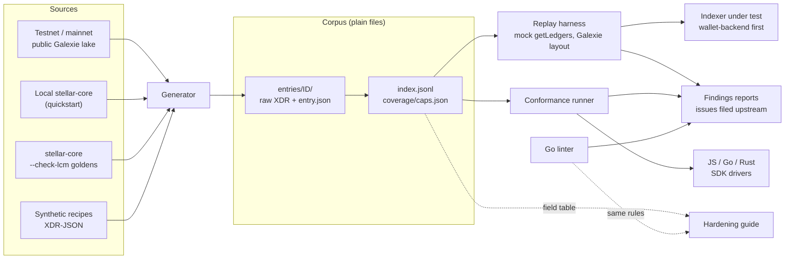
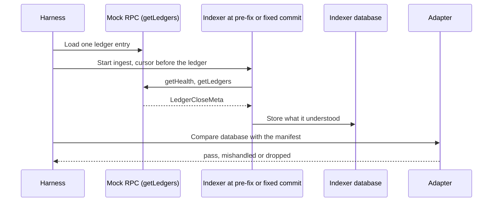

# Technical Architecture

Design of the full kit proposed to the SCF RFP [XDR/CAP-Coverage Audit Tool and Indexer-Hardening Guide](https://stellar.gitbook.io/scf-handbook/scf-awards/build-award/rfp-track#current-open-rfps). This repository is the prototype it builds on.

## Summary

The XDR Conformance Kit is a shared, offline test kit for software that reads the Stellar ledger: indexers, ETL pipelines, wallet backends and SDKs. Rare but valid ledger shapes keep breaking these readers, and each team rediscovers the same bugs on its own. The RFP lists 18 public sightings from September and October 2026, 16 of them defects.

The kit turns each shape into a corpus entry that every reader can run in CI, so a bug found once becomes a regression test for everyone:

- **Corpus and generator**: CAP-tagged XDR entries with a manifest of expected results.
- **Replay harness**: replays the corpus into an indexer and reports what it mishandles or drops.
- **SDK conformance runner**: the same corpus through the JS, Go and Rust SDKs.
- **Go linter** for the three ingestion mistakes, and an **indexer-hardening guide** for developers.stellar.org.
- **Findings reports**: every failure triaged and filed upstream.

This repository is the working prototype. It has the draft manifest schema, 10 sample entries and all six bugs named in the RFP's reviewer checks reproduced, each failing before its fix and passing after.

## 1. Architecture

In plain English:

1. The **generator** produces entries from four sources and writes them as raw XDR files with one JSON manifest each. A generated index lists them all.
2. The **replay harness** serves each ledger entry to an indexer the way a real network would, then compares what the indexer stored with what the manifest says it should have stored.
3. The **conformance runner** feeds each entry to every SDK and checks decoding, expected values and byte-identical re-encoding.
4. The **linter** reads indexer source code for the three mistakes. The **guide** explains the same rules for any language.
5. Every failure becomes a triaged **finding**, filed upstream and linked back to its entry.

Built with: Python for the generator, harness and runner orchestration (as in the prototype), one thin driver per SDK in its own language, Go for the linter, rs-stellar-xdr as the reference decoder.

## 2. Corpus and manifest

- **One entry per pattern.** An entry is either one whole `LedgerCloseMeta` (for indexers) or one other XDR value such as an `ScVal` or `MuxedAccount` (for SDKs). A whole ledger is what core emits and what Galexie and RPC serve, and it's the only place where the envelope and the meta sit together, which the participants-from-meta rule needs.
- **Raw XDR, one value per file**, identified by its SHA-256. No base64, framing or compression at rest. The harness adds those when it builds a layout.
- **One manifest per entry** (JSON Schema 2020-12): ID, CAPs, protocol range, provenance, synthetic flag, the shapes exercised and whether core validates each one, and the expected results.
- **Expected results** are written against the entry's XDR-JSON form (SEP-51): decoded values by JSON Pointer, a byte-identical round trip through rs-stellar-xdr, the full participant set derived from the meta, the ledger changes core made, and SDK operation checks for defects a plain decode doesn't show.
- **Generated index** (`index.jsonl`), streamed line by line. Tools filter on CAP, protocol, kind or root cause and open only the entries they need, so memory stays proportional to one entry.
- **CAP coverage file** (`coverage/caps.json`): each CAP, its protocol, its shapes, its entries and its gaps. No machine-readable CAP-to-XDR mapping exists today, so we build it. CAP tags are assigned by hand, because CAP-0073 changed no XDR yet caused two of the sightings.
- The full schema and its rationale are in the repo: [`manifest-schema.md`](manifest-schema.md).

## 3. Generator and provenance

The RFP wants XDR that stellar-core would actually emit, not just XDR that decodes. Every entry records where its bytes came from:

| Source | How | Example in the prototype |
| --- | --- | --- |
| Network history | Fetched once from the public Galexie lake, no keys or funds | Testnet ledger 4437357, wallet-backend #729 |
| Local stellar-core | quickstart with a pinned core version and protocol, testnet or mainnet passphrase | Muxed source on a Soroban TTL operation, wallet-backend #753 |
| `--check-lcm` goldens | Copied by repository, commit, path and record, re-verified in CI | SAC-created trustline, wallet-backend #731 |
| Synthetic | Encoded from XDR-JSON recipes, flagged `synthetic`, with a stated `coreCanEmit` | Colliding map keys, js-stellar-sdk #1789 |

- Local-core runs are reproducible in shape, not in bytes (close times come from the clock). So the bytes are committed, the recipe and core version are recorded, and a regenerated entry must pass its own expected results.
- The generator can produce one shape at several protocol versions. This matters: a pre-fix commit can only replay a ledger its XDR understands, which we hit while reproducing #731.
- Entries that core can never emit stay out of the replay harness and serve SDK conformance only.

## 4. Replay harness

- **First input: a mock RPC `getLedgers` endpoint.** wallet-backend can read from RPC or from a Galexie datastore, but its datastore backend only accepts S3, so the mock is the simplest path. It's about a hundred lines and already reproduces #729, #731 and #716.
- **Second input: the Galexie layout.** The harness writes the same entries as a Galexie data lake (`.config.json`, zstd `LedgerCloseMetaBatch` objects) behind a local S3-compatible endpoint. The verdicts must match the RPC path.
- **Adapter interface.** An adapter starts the target, feeds it, and maps its stored data back to the manifest's participants and ledger changes. wallet-backend is the reference adapter. stellar-etl and third-party indexers can add their own.
- **Bounded memory.** One entry, or a small group, per target run, inside a container with a memory cap. Unbounded growth becomes a verdict instead of a crashed CI runner.
- **Pre-fix and fixed runs.** Each sighting records its pre-fix and fixed references, so CI shows the regression test failing before the fix and passing after.

## 5. SDK conformance runner

- A Python orchestrator and one thin driver per SDK (js-stellar-sdk, go-stellar-sdk, rs-stellar-xdr), speaking JSON lines. Adding Python or Java later means adding a driver.
- For each value entry, each driver decodes the bytes, checks the expected values, re-encodes, and runs the operation checks it supports. Unsupported checks report `skipped`.
- The output is a **divergence matrix**: entry by SDK by check, compared with the network and with the other SDKs.
- When one SDK fails, we check the others and file sibling issues in each affected SDK, linked to the entry.
- The prototype's JS driver already reproduces js-stellar-sdk #1766, #1785 and #1789 on the published pre-fix releases.

## 6. Linter

Built on Go's standard `go/analysis` framework, so it runs in `go vet`, golangci-lint or CI with no new tooling. Go, because the first target pipeline, wallet-backend, is Go.

| Rule | Flags |
| --- | --- |
| XCK001 Unvalidated field | Memo text, Soroban auth trees or muxed IDs used as if core had validated them |
| XCK002 Missing caps | Recursion over auth trees or nested `ScVal`s without depth or size limits |
| XCK003 Participants from envelope | Affected accounts derived from the envelope instead of the ledger meta |

Each rule maps to a root-cause tag in the manifest (`unvalidated-passthrough`, `unbounded-resource`, `participants-from-envelope`). The linter flags every seeded violation in its test suite, with no false positives on current wallet-backend.

## 7. Indexer-hardening guide

- Fixed outline: validated versus unvalidated fields, recommended caps, participants from meta, muxed and signed-payload addresses (SEP-0023 strkeys), and the linter's checklist for other languages.
- The field-by-field table is generated from the manifests' `coreValidation` values, so the guide and the corpus can't disagree.
- Published as a PR to developers.stellar.org once a core or platform engineer has reviewed it, as the RFP requires.

## 8. Findings and disclosure

- Each failure is triaged with severity, affected CAP, component and the minimal reproducing entry, then filed upstream. The findings report maps every failure to an issue.
- Some findings let anyone halt an indexer by submitting a transaction. Those go first through the project's security policy as private reports, and become public only after the fix.

## 9. Infrastructure, security and maintenance

- **No hosted infrastructure.** Everything runs offline in GitHub Actions or on a laptop, with no keys, funds or network access. No user tracking of any kind.
- **CI**: schema checks, round trips and SDK checks run on every pull request in minutes. Ledger replays run on pull requests that touch them, and nightly in full.
- **Monitoring plan**: the nightly job runs the corpus against the main branches of wallet-backend and the three SDKs, and opens an issue when a verdict regresses.
- **Security**: the kit parses hostile XDR by design, so targets run in containers with resource limits. Dependencies and CI actions are pinned, and releases are signed. The full STRIDE threat model is a Tranche #2 deliverable.
- **Stellar stack**: built against the latest stable releases (stellar-core and rs-stellar-xdr 30.0.0, current SDKs).
- **Maintenance**: Walnut maintains the kit for 12 months after delivery. When a protocol upgrade ships, new CAPs get planned entries, shapes are regenerated at the new protocol, and a new release supports it. After that, the corpus is plain files that SDK and indexer teams can keep extending.

## 10. Decentralization, license and community

- **Decentralization**: not applicable to a test kit. Nothing is hosted and nothing runs on-chain. The corpus is plain files that anyone can fork, run and extend.
- **License**: Apache-2.0, with attributions for stellar-core goldens and network data in `NOTICE`.
- **In the open**: all work happens in the public repo, with progress posts in the SCF GitHub discussion and the Stellar Dev Discord at each tranche and monthly during maintenance.

## 11. Milestones

| Tranche | Deliverables |
| --- | --- |
| #1 | Corpus v1 and generator with the CAP coverage file, replay harness with mock `getLedgers` and the wallet-backend adapter |
| #2 | SDK conformance runner, Galexie-layout replay, Go linter, threat model and monitoring plan |
| #3 | Hardening guide, findings report, v1.0 release, then maintenance through the first protocol upgrade |
